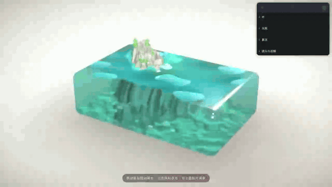

# 树脂块微缩岛屿 · Resin Island

一块"树脂"里封着一座微缩岛屿：陡峭悬崖、一弯沙滩、清澈的青绿海水。
全屏交互场景 —— 整块像果冻一样跟随鼠标弹簧晃动，水面随鼠标起涟漪，空闲时也有自然波动。

全部 3D 内容由代码程序化生成，不加载任何模型文件。



**[▶ 观看演示视频（MP4）](docs/demo.mp4)** · 图文教程：[当 AI 给出一张"树脂岛屿"，我用 Three.js 把它做成了真的](http://easin.l.cd/)

## 运行

```bash
npm install
npm run dev      # http://localhost:5173
npm run build    # 产物在 dist/
```

## 交互

- **移动鼠标**：搅动水面产生涟漪，整个树脂块做弹簧式果冻晃动（顶部比底部晃得多）
- **点击水面**：激起浪花 + 果冻受到冲击
- **右上面板（leva）**：水色 / 浪高 / 涟漪强度 / 泡沫宽度 / 潮位 / 太阳角度与强度 / 焦散 / 果冻软硬阻尼 / 景深 / 泛光 / 暗角

## 技术实现

| 部分 | 方案 |
| --- | --- |
| 树脂块 | drei `RoundedBox` + `MeshTransmissionMaterial`（折射、色散、吸收着色） |
| 水体颜色 | 材质衰减（attenuation）+ 水面着色器按水深混色，浅水透出烘焙的海床反照率（假折射） |
| 水面模拟 | GPU 高度场：`(高度, 速度)` 双通道半浮点 ping-pong，波动方程积分，高斯 splat 注入涟漪（`src/lib/waterSim.ts`，hook 封装 `useWaterSimulation`） |
| 水面着色 | `MeshPhysicalMaterial` + `onBeforeCompile` 注入：顶点位移（模拟场 + 三层环境涌浪）、解析法线、水深混色、岸边泡沫 / 拍岸浪环 / 涟漪浪尖泡沫 |
| 地形 | 种子化 simplex 噪声（`src/lib/noise.ts`）：海床 + 一角岛屿，沙滩侧坡度放缓成月牙形；按高度/坡度分层顶点色（深水沙→湿沙→干沙→草甸→岩崖层理） |
| 焦散 | 地形材质注入多次折射干涉纹样，仅水面以下生效，随深度衰减 |
| 岛屿破水 | 水面贴近块口（潮位可调），悬崖穿出块顶；岸线交到处自动生成泡沫 |
| 植被/岩石 | drei `Instances` 实例化：低多边形松树/灌木/草茎按高度坡度拒绝采样散布；顶点扰动 + flatShading 碎岩 |
| 果冻 | 欠阻尼弹簧跟随指针（`useJelly`），以块底为支点做平移 + 倾转；水面着色器内叠加滞后"晃荡"梯度 |
| 呈现 | 米白背景、长焦俯视相机（竖屏自动拉远）、drei `ContactShadows`、`EffectComposer`（SMAA + 景深微缩感 + 轻泛光 + 暗角）、`Environment preset="studio"`（加载失败自动降级为纯灯光） |
| 性能 | 三档质量（`src/state/quality.ts`）：DPR / 模拟分辨率 / 透射采样 / 景深开关；帧率守卫每 2.5s 统计，<33fps 自动降档 |

## 目录结构

```
src/
  App.tsx                 Canvas 装配 + 相机适配
  state/params.ts         leva 调参面板
  state/quality.ts        质量分档与帧率守卫 store
  hooks/useWaterSimulation.ts   水面模拟 hook
  hooks/useJelly.ts       果冻弹簧
  lib/noise.ts            种子化 simplex / fbm / ridged
  lib/terrain.ts          地形高度场、分层着色、数据纹理烘焙、撒点
  lib/waterSim.ts         GPU 高度场模拟器
  lib/textures.ts         程序化沙粒凹凸贴图
  scene/                  Experience / ResinBlock / WaterSurface / Terrain /
                          Rocks / Vegetation / JellyGroup / Effects
scripts/terrain-profile.ts 地形剖面调试脚本（node 直接运行）
```

## 调试

- `?wd=1` 水面输出地形高度灰度；`?wd=2` 输出 uv；`?wd=3` 输出模拟纹理状态
- 开发模式下 `console.error` 会显示在页面左下角浮层（便于无头截图排查着色器错误）
